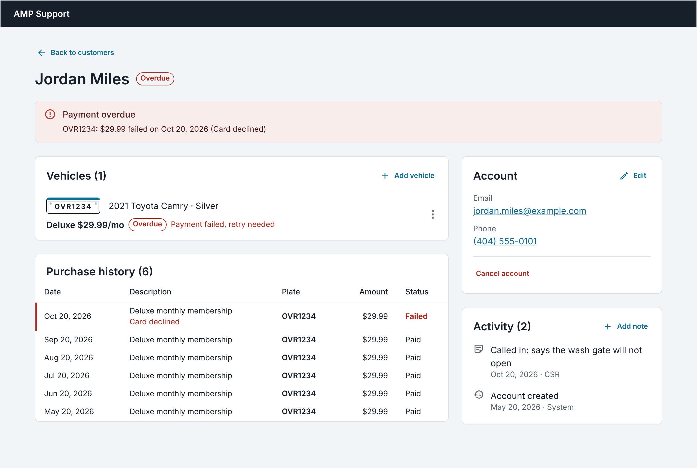

# AMP CSR Portal

A customer service portal for AMP car wash memberships. A CSR can find a customer, check their account, vehicles, and billing, and fix the common problems that come up on a support call.

**Live demo:** https://amp-csr.onrender.com
No login needed. All customers are generated demo data.



## What it does

| Requirement                         | Where                                                                                                                                                  |
| ----------------------------------- | ------------------------------------------------------------------------------------------------------------------------------------------------------ |
| View a list of users                | Customer list: paginated table with name, email, phone, plates, and status                                                                             |
| Find and view a user's details      | One search box for name, email, phone, or plate. The detail page shows account info, vehicles with memberships, purchase history, and activity         |
| Edit account info                   | **Edit** on the Account card: name, email, phone                                                                                                       |
| View and edit vehicle subscriptions | Each vehicle's ⋮ menu: **start** a membership, **change plan**, **transfer** it to another car, or **cancel** it. Vehicles are added and removed there too |

### The four support calls

| Call                                                                  | How a CSR handles it                                                                                                                  |
| --------------------------------------------------------------------- | ------------------------------------------------------------------------------------------------------------------------------------- |
| "I want to cancel my account."                                        | **Cancel account** on the Account card ends every membership in one step, with a reason. For one car, **Cancel membership** in its ⋮ menu |
| "I have a question about a recent purchase."                          | Purchase history: date, description, plate, amount, status, and why a charge failed                                                   |
| "I purchased a new vehicle and I want my subscription transferred."   | ⋮ → **Transfer membership** → a new vehicle, optionally removing the old car in the same step                                         |
| "I am not able to get a wash." (overdue)                              | The overdue banner says which car, how much, when, and why; ⋮ → **Retry payment**                                                     |                                                     |     |     |

### Beyond the brief

- **Status tabs with counts** (All, Overdue, Active, No membership), with overdue accounts flagged in red
- **Search, tab, and page live in the URL**, so refresh, the back button, and shared links keep the CSR's place, and "Back to customers" returns to the same results
- **Overdue banner** on the detail page showing which car, how much, when, and why the charge failed
- **Activity log**: every change is recorded automatically with what it was before and after
- **Every vehicle action in one place**: the ⋮ menu groups actions into Membership, Payment, and Vehicle. Unavailable actions stay visible with the reason (for example "Cancel or transfer the membership first"), and keyboard and screen reader users can reach those reasons too
- **Plan cards**: starting a membership or changing plans shows the plans side by side with what each includes, so the CSR can explain the difference. The button says what happens to the money: "Start and charge $29.99", or no charge today for a plan change
- **Transfer options**: move a membership to an existing car or a new one, and optionally remove the old car in the same step (the "I sold my car" call)
- **Retry payment** for an overdue membership, with a confirm that shows the amount before charging
- **Cancel account** for customers with several cars: one step that ends every membership in a single save, warns about unpaid charges, and keeps the account and history so the customer can rejoin
- **CSR notes** on the account for whoever takes the next call, shown in the activity log alongside automatic changes
- **Two CSRs, one customer**: account edits and plan changes carry the version the CSR loaded, so a save made from an out-of-date page is rejected instead of overwriting a newer change. The dialog says so and the page quietly reloads the latest data
- Validation on both the client (instant feedback) and the server (the source of truth), with server errors shown in the dialog without losing what was typed
- **Unit tests** for the billing, status, search, and error rules (`npm test`)

## Try it

The seed includes one customer for each common support call:

| Customer     | Situation                            | Try                                                                                                                                                   |
| ------------ | ------------------------------------ | ----------------------------------------------------------------------------------------------------------------------------------------------------- |
| Jordan Miles | Overdue: latest charge declined      | Retry his payment from the ⋮ menu and watch the banner clear. Or add a second car and transfer his membership to it; the overdue status moves with it |
| Priya Shah   | Two cars, both on active memberships | Try to remove a car (blocked, with the reason). Transfer one membership to a new car. Or **Cancel account** to end both in one step                   |
| Marcus Bell  | Cancelled membership                 | Start a new membership on his car, or remove it (allowed, since the membership is cancelled)                                                          |
| Elena Ruiz   | No membership, single washes only    | Add a car, then start a membership from its ⋮ menu and watch the charge appear in purchase history                                                    |

Searching `404 555` finds all four by phone. Searching a plate like `ovr-1234` works too.

## Tech stack

- **Client:** React 19, TypeScript, Vite, MUI, React Router
- **Server:** Node, Express 5, TypeScript, Mongoose
- **Database:** MongoDB Atlas
- **Hosting:** Render, with one service serving both the API and the built client

## Run locally

Requires Node 22.12 or later and a MongoDB connection string (Atlas or local).

```bash
npm run install-all
cp server/.env.example server/.env   # then set MONGODB_URI
npm run seed                         # loads demo data (replaces existing data)
npm run dev                          # client on http://localhost:5173, API on :3001
npm test                             # server unit tests
```

In development, Vite proxies `/api` to the Express server. For a production build: `npm run build`, then `NODE_ENV=production npm start`. If your network can't resolve the Atlas address (seen on some Windows setups), set `DNS_SERVERS=8.8.8.8,1.1.1.1` in `server/.env`.

## Project structure

```
client/src/
├── api/              fetch wrapper and one function per endpoint
├── pages/            customer list and customer detail
├── components/       shared: FormDialog, CancelReasonField, StatusChip, PlateBadge
│   ├── customer/     account card, purchases, activity, overdue banner
│   └── vehicle/      vehicle rows, actions menu, plan cards, action dialogs
├── hooks/            useDebounce, useVehicleForm
└── utils/            formatting and form validation

server/
├── models/           Customer (vehicles embedded), Purchase, Activity
├── routes/           URL → controller mapping
├── controllers/      request handling
├── middleware/       errorHandler
├── utils/            business rules: status, billing dates, cancellation, search
├── tests/            Vitest + Supertest unit tests
└── seeds/            reproducible demo data

```

Full API reference: [server/README.md](server/README.md)

## Key decisions

- **Vehicles and subscriptions are embedded in the customer.** They're few per customer and always shown together, so one query loads the whole page. Purchases and activity are separate collections because they grow without limit. Each purchase keeps a snapshot of the plate, so receipts stay accurate after a transfer or removal.
- **Customer status is derived, not stored by hand.** A plain function (`deriveCustomerStatus`) runs on every save and recalculates it from the subscriptions (overdue beats active beats inactive), so it can't drift out of sync, and the rule is unit tested.
- **Money is in cents, and the price is locked onto the subscription** at signup, so a future plan price change doesn't affect existing members.
- **Transfers keep the membership exactly as it is**, including an overdue status, so a customer can't escape a failed payment by switching cars.
- **The URL is the single source of truth for the list.** Search, status, and page are read from the URL, and the search box writes to it after a 300ms pause.
- **After a save, the detail page refetches quietly.** A write can also add activity entries or purchases, so reloading everything is simpler and safer than patching pieces of local state. The current data stays on screen meanwhile, so there's no spinner flash.
- **One shared dialog shell (`FormDialog`)** handles the error alert, saving spinner, and blocking close mid-save, so each dialog only defines its fields and what happens on submit.
- **One deployed service.** Express serves the built React app with a fallback to `index.html` for client-side routes, so there's one URL, no CORS setup, and the client calls a relative `/api`.
- **Two layers of conflict protection.** Every save checks the customer's version (Mongoose optimistic concurrency), so two requests racing on the server can't both apply; this is what stops a double click on "retry payment" from charging twice. That alone doesn't catch a CSR acting on a page loaded minutes earlier, so edits that no business rule guards (account details, plan changes) also send the version the CSR loaded, and the server returns 409 if it has moved on. Other actions are already guarded by their rules ("has no active membership", "already has a membership").
- **Adding a car and starting a membership are separate steps**, so the flow is the same whether the car is new or has been on the account for years.
- **Cancelling an account ends memberships; it doesn't delete anything.** Every membership is cancelled in one save, so it can't half-succeed, and the account, vehicles, purchases, and activity stay for the next call or a rejoin.

## Known limitations and next steps

- **Integration tests.** Unit tests cover the pure business rules (`npm test`). Next would be API tests for transfer, the remove guard, and retry against an in-memory MongoDB, then a few end-to-end flows with Playwright.
- **Write ordering and transactions.** A membership write saves the customer first, then records the purchase and activity separately. If the purchase insert failed, the membership would be active without a recorded charge. With a real payment provider I'd charge first (with an idempotency key), then update the membership, and wrap the writes in a MongoDB transaction.
- **Payments are simulated.** Every charge succeeds except the seeded failures. A real version would use a payment provider and add a card-update flow, since retrying an expired card won't work.
- **Cancellation is immediate.** There's no end-of-period cancellation or prorated refund. A production version would schedule the cancellation for the end of the paid period.
- **Refunds.** Purchases can be viewed but not refunded. The purchase model already has `refunded` and `refundReason` fields for a refund action.
- **Unpaid balances.** Cancelling keeps a failed charge in purchase history, but nothing tracks an outstanding balance on the account.
- **Billing day.** Month-end dates are clamped (Jan 31 + 1 month = Feb 28), but a member who joined on the 31st then bills on the 28th from then on. Storing the original billing day would bring it back to the 31st when the month allows.
- **Authentication.** There's no login, and every change is logged as "CSR". In production the author would come from the signed-in user, with roles for who can cancel or refund.
- **Vehicle removal is a hard delete.** Purchases keep a snapshot of the plate, but the removed plate is no longer searchable. A soft delete would keep it findable for billing questions.
- **Dates use the browser's time zone.** Billing dates should show in the account's time zone, so every CSR quotes the same date.
- **Search at scale.** Regex search is fine for a demo but doesn't scale; Atlas Search would.
- **Shared types.** Plan definitions and API types are mirrored between the client and server. At scale both would import them from a shared package.
- **A plate can be on two accounts.** Cars get sold, so this is allowed, but two live memberships on one car across accounts could be abused and would deserve a check.
